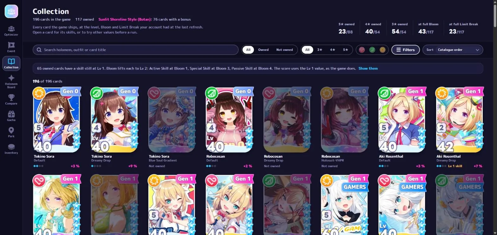

# holobuilder

**The team optimizer for _hololive Dreams_, on your own PC.**

Your best leader and five members for any song, every point of the Unit Score explained, the
Holomem Board nodes worth unlocking next, and the event borders read around the clock.

[**⬇ Download the installer**](../../releases/latest) &nbsp;·&nbsp; Windows 10 / 11 &nbsp;·&nbsp; free

 

---

## What it does

<table>
<tr>
<td width="50%"></td>
<td><h3>Find your best team</h3>Every leader and five members, scored exactly on the chart you pick: your cards as they are, your Holomem Boards planned. One song in about 15–40 seconds.</td>
</tr>
<tr>
<td></td>
<td><h3>Every point explained</h3>The Unit Score the game shows, line by line, and the whole score distribution: expected, max, and how often a run beats it.</td>
</tr>
<tr>
<td></td>
<td><h3>What to unlock next</h3>The board nodes that lift the team most for the points you hold: what to unlock, what to reset, where each Connect card goes.</td>
</tr>
<tr>
<td></td>
<td><h3>Event borders, live</h3>Every tier's border every five minutes, where it will end, the top 100, and the Event Pt you need to finish inside.</td>
</tr>
<tr>
<td></td>
<td><h3>Your whole collection</h3>Every card the game ships at your level, Bloom and Limit Break, with this event's bonus on each.</td>
</tr>
<tr>
<td></td>
<td><h3>Your luck, honestly</h3>Every pull tracked and set against the published rates, banner by banner.</td>
</tr>
</table>

## Install

1. Download **`holobuilder-setup.exe`** from the [latest release](../../releases/latest) and run it.
   No administrator rights: it installs for your Windows user only.
2. **Sign in with Google** in the installer. This only asks the owner for access: holobuilder is
   a small, private project and every user is approved by hand. You can leave the installer open
   while you wait; it continues on its own once you are approved.
3. Press **Install**. The first start asks for your game's **account file** (the app finds it for
   you if the game is installed on that PC), reads your account and downloads the game data —
   about a minute, once.

Updates are one click: when a new version is out, the app says so and installs it, keeping your
settings and data.

## Privacy

holobuilder is built so that **nobody — not even the server's owner — can see your game account.**

| | Where it goes |
|---|---|
| Your game account file | **Stays on your PC.** It is read where it is, at each refresh, and never copied or uploaded. |
| Your cards, boards, items | **Read by your PC directly from the game's servers.** They never pass through holobuilder's server. |
| Your Google sign-in | The server keeps your **name and email** — so the owner knows who asked — plus when you last connected and your app version. |
| Your IP address | **Not stored, not logged.** |
| Your access key | Created for your PC alone; the server keeps only a one-way hash of it. |

## Security

- **Signed releases.** Every app version and every data update is signed with the owner's
  private key, which never leaves the owner's PC. The installer and the app refuse anything that
  does not carry that signature, so a compromised server could not push code or data to you.
- **No secrets in this repository or in the installer.** The only credential inside the installer
  is Google's public "installed app" client id, which is safe to publish by design (the sign-in
  uses PKCE and a local redirect).
- **Access can be withdrawn at any time** by the owner, per user, and takes effect on the next
  request.
- Runs locally: the app's engine only listens on `127.0.0.1`.

## FAQ

**Does it touch the game?** No. It never modifies the game or your account. Refreshing reads your
account the same way the game does when it starts.

**Do I need the game installed on the same PC?** No — only its account file. Copy it from the PC
that has the game and point the app at it in Settings.

**Why "approved by hand"?** The app serves the game's data, so access is kept to people the owner
knows.

---

A fan-made tool, not affiliated with or endorsed by COVER Corporation or QualiArts. hololive,
hololive Dreams and all character art, music and game data belong to their respective owners.
