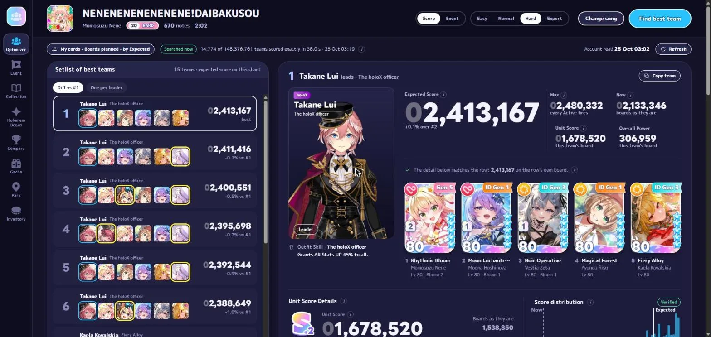
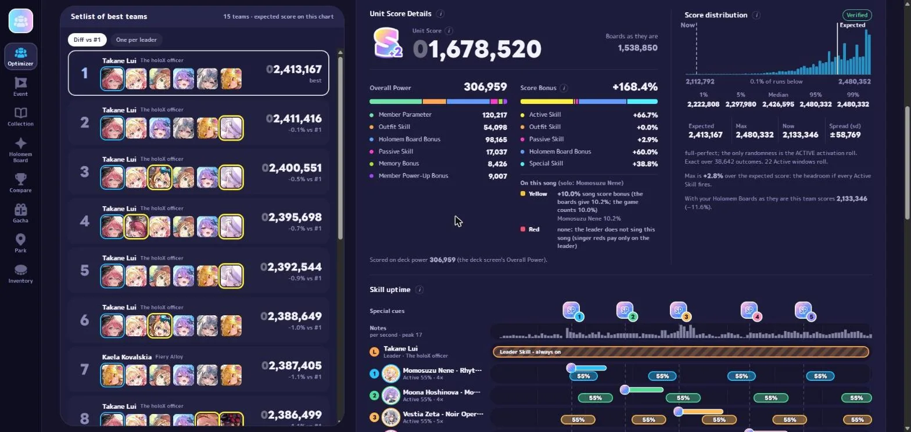
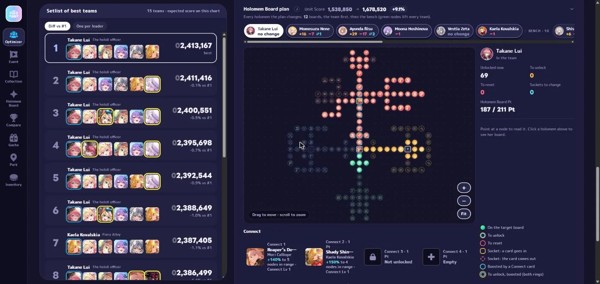
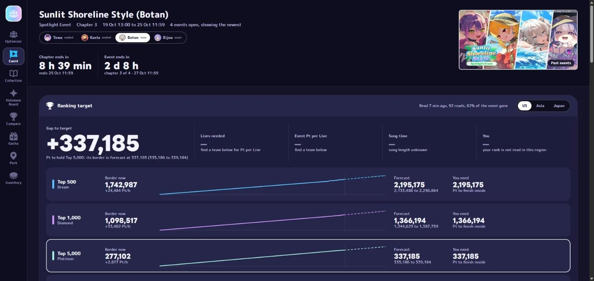
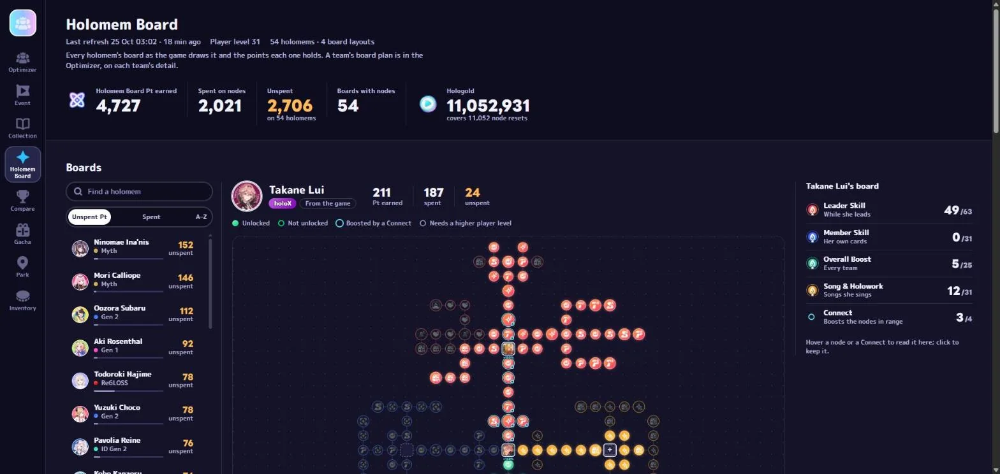

<div align="center">


# holobuilder

**Team optimizer for hololive Dreams.**

Find the best teams for every song, plan your Holomem Boards and follow the event rankings.

[**Download for Windows**](../../releases/latest) · [**Run it from source**](docs/run-locally.md)

<br>



</div>

## Features

| | |
|---|---|
| <br>**Team optimizer**<br>The best leader and members for any song, using your own cards. | <br>**Score breakdown**<br>Unit Score and score distribution, line by line. |
| <br>**Board planner**<br>Which Holomem Board nodes to unlock next. | <br>**Holomem Boards**<br>Every board and its points at a glance. |
| <br>**Event tracker**<br>Live borders, forecasts and the top 100. | <br>**Gacha tracker**<br>Your pulls compared with the official rates. |

## Two ways to use it

| | The app | From source |
|---|---|---|
| Install | `holobuilder-setup.exe` | this repository, Python and a C compiler |
| Needs the game on the same PC | no | yes: the data is built from your install |
| Access | Google sign-in, approved by hand | none |
| Game data and pictures | downloaded from the holobuilder server | built from your game and the game's servers |
| Updates | automatic | `git pull`, then `refresh.cmd` |

In both cases the optimizer runs on your PC and your account is read straight from the game.

**The app:** download `holobuilder-setup.exe` from [Releases](../../releases/latest), sign in with
Google and wait for approval; the installer does the rest. See [Getting started](docs/getting-started.md).

**From source:** you need Windows, the game installed and started once,
[Python 3.13](https://www.python.org/downloads/windows/) and `gcc`
(`winget install BrechtSanders.WinLibs.POSIX.UCRT`).

```
git clone https://github.com/JSarvise/holobuilder
cd holobuilder
.\setup.cmd
.\refresh.cmd
.\start.cmd
```

`setup.cmd` installs the Python packages and lists anything missing, `refresh.cmd` reads the game
and your account (about 20 minutes the first time), and `start.cmd` opens
<http://127.0.0.1:8731/optimizer>. Details: [Run it from source](docs/run-locally.md).

## Privacy

Your account file stays on your PC and is only sent to the game's own servers. The app's server
keeps your Google email, your username and your app version; running from source sends nothing to
us. See [Privacy](docs/privacy.md).

## Documentation

- [Getting started with the app](docs/getting-started.md)
- [Run it from source](docs/run-locally.md), [the game's build constants](docs/dev/game-keys.md),
  [your own server](docs/self-hosting.md)
- [Using holobuilder](docs/guide.md) and the [options glossary](docs/options.md)
- [Troubleshooting](docs/troubleshooting.md) · [Privacy](docs/privacy.md)
- [Contributing](CONTRIBUTING.md) · [Architecture](ARCHITECTURE.md) · [Security](SECURITY.md)

## Source layout

The optimizer is in `src/hbuilder`, the local web app in `tools/web`, the scripts that read the
game and your account in `tools/recon`, the launchers in `tools/local`, and the desktop app with
its installer and server in `tools/app`. Run the tests with `.venv\Scripts\python -m pytest`;
the ones that need game data are skipped until a refresh has built it.

## License

[GNU AGPL-3.0](LICENSE). You may use, study, change and share this code. If you distribute it, or
run a modified version as a service for others, you must publish your changes under the same
license and keep the copyright and attribution notices.

## Disclaimer

holobuilder is an unofficial fan-made tool, not affiliated with or endorsed by COVER Corporation,
QualiArts or hololive production. hololive and hololive Dreams are trademarks of their owners; the
game's assets are theirs and are not included here. Third-party tools may go against the game's
terms of service; use it at your own risk. See [NOTICE](NOTICE).
