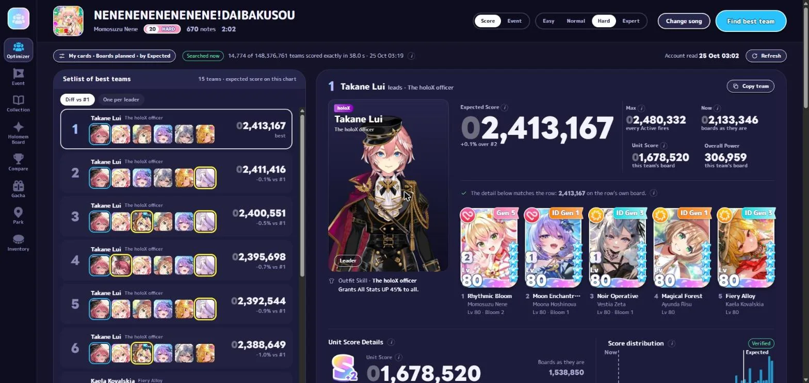
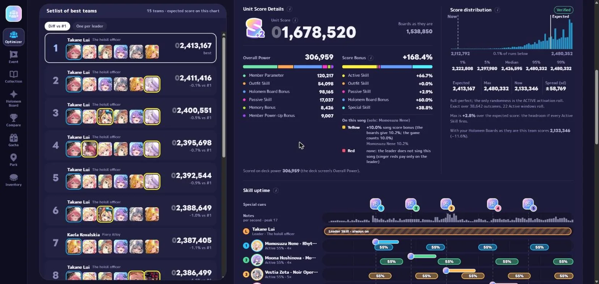
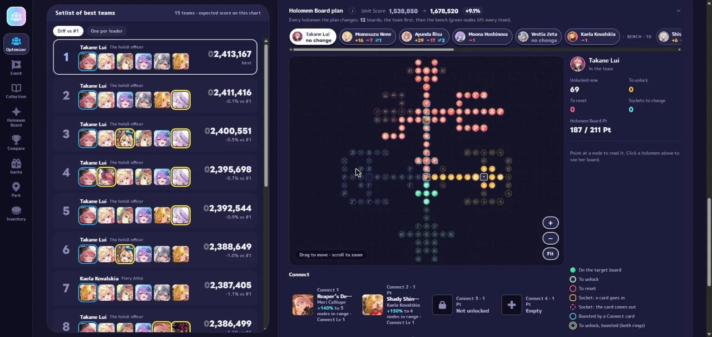
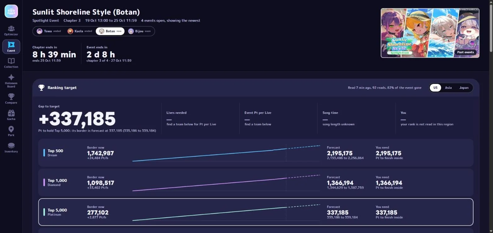
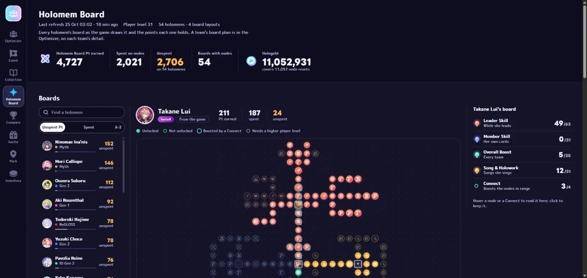

<div align="center">


# holobuilder

**Team optimizer for hololive Dreams.**

Find the best teams for every song, plan your Holomem Boards and follow the event rankings.

[**Download for Windows**](../../releases/latest) · [**Run it from source**](docs/run-locally.md)

<br>



</div>

## Features

| | |
|---|---|
| <br>**Team optimizer**<br>The best leader and members for any song, using your own cards. | <br>**Score breakdown**<br>Unit Score and score distribution, line by line. |
| <br>**Board planner**<br>Which Holomem Board nodes to unlock next. | <br>**Holomem Boards**<br>Every board and its points at a glance. |
| <br>**Event tracker**<br>Live borders, forecasts and the top 100. | <br>**Gacha tracker**<br>Your pulls compared with the official rates. |

Also: **Compare** (two teams side by side, skill by skill), **Park** (today's Free Chats and hidden
collectables), **Collection** and **Inventory** (everything your account holds).

## How it works

A refresh reads the game's own data: the master tables (cards, skills, Holomem Boards, events)
and every song chart from your install and the game's servers, and your account (each card's
level, bloom and SP training, the board nodes you bought, your items). Nothing is typed in by
hand: card stats use the game's own 32-bit formulas, and a team's Unit Score matches the deck
screen line by line.

The optimizer scores a team on a song note by note: the team's Overall Power is shared among the
notes, and each note is multiplied by the skills live at that instant. Active skills fire at
random, so it reports the expected score, the maximum and the whole distribution. The search
chooses a leader and five members among your cards (a quick screen proposes, the exact scorer
decides), plans each holomem's board as an integer program, and ranks the teams by expected
score. The hot loops also exist as small C kernels that give bit-identical results. The whole
model, formula by formula: [How a team is scored](docs/score-model.md).

## Two ways to use it

| | The app | From source |
|---|---|---|
| Install | `holobuilder-setup.exe` | this repository, Python and a C compiler |
| Needs the game on the same PC | no | yes: the data is built from your install |
| Access | Google sign-in, approved by hand | none |
| Game data and pictures | downloaded from the holobuilder server | built from your game and the game's servers |
| Runs on | Windows | Windows and Linux |
| Updates | automatic | `update.cmd` (`update.sh` on Linux): the newest version, then a refresh |

In both cases the optimizer runs on your PC and your account is read straight from the game.

**The app:** download `holobuilder-setup.exe` from [Releases](../../releases/latest), sign in with
Google and wait for approval; the installer does the rest. See [Getting started](docs/getting-started.md).

**From source:** you need the game installed and started once, Python 3.12 or newer (3.13 is
the tested one) and `gcc`. On Windows: [Python 3.13](https://www.python.org/downloads/windows/)
and `winget install BrechtSanders.WinLibs.POSIX.UCRT`. On Linux, with the game under Proton:
`sudo apt install python3 python3-venv gcc libsqlcipher1` (or your distribution's equivalent).

```
git clone https://github.com/JSarvise/holobuilder
cd holobuilder
.\setup.cmd      # Linux: ./setup.sh
.\refresh.cmd    # Linux: ./refresh.sh
.\start.cmd      # Linux: ./start.sh
```

`setup` installs the Python packages and lists anything missing, `refresh` reads the game and
your account (about 20 minutes the first time), and `start` opens
<http://127.0.0.1:8731/optimizer>. Details: [Run it from source](docs/run-locally.md).

## Privacy

Your account file stays on your PC and is only sent to the game's own servers. The app's server
keeps your Google email, your username and your app version; running from source sends nothing to
us. See [Privacy](docs/privacy.md).

## Documentation

- [Getting started with the app](docs/getting-started.md)
- [Run it from source](docs/run-locally.md), [the game's build constants](docs/dev/game-keys.md),
  [your own server](docs/self-hosting.md)
- [Using holobuilder](docs/guide.md) and the [options glossary](docs/options.md)
- [How a team is scored](docs/score-model.md): the score model, formula by formula, with the code behind each
- [Troubleshooting](docs/troubleshooting.md) · [Privacy](docs/privacy.md)
- [Contributing](CONTRIBUTING.md) · [Architecture](ARCHITECTURE.md) · [Security](SECURITY.md)

## Source layout

| Folder | What it is |
|---|---|
| `src/hbuilder` | the model and the searches: cards, skill gates, scoring, Holomem Boards (standard library only) |
| `tools/web` | the local web app: the server package `hbweb/`, the search engines, the C kernels, the pages in `static/` |
| `tools/refresh` | the refresh: reads the game and your account into `tools/recon/proxy/dumps/` |
| `tools/local` | what `setup`, `refresh` and `start` run |
| `tools/app` | the Windows desktop app: launcher, installer, updates, its server |
| `tests` | the tests (more sit beside the code as `test_*.py`) |

How the pieces fit: [ARCHITECTURE.md](ARCHITECTURE.md). Run the tests with
`.venv\Scripts\python -m pytest` (`.venv/bin/python` on Linux); the ones that need game data are
skipped until a refresh has built it.

## License

[GNU AGPL-3.0](LICENSE). You may use, study, change and share this code. If you distribute it, or
run a modified version as a service for others, you must publish your changes under the same
license and keep the copyright and attribution notices.

## Disclaimer

holobuilder is an unofficial fan-made tool, not affiliated with or endorsed by COVER Corporation,
QualiArts or hololive production. hololive and hololive Dreams are trademarks of their owners; the
game's assets are theirs and are not included here. Third-party tools may go against the game's
terms of service; use it at your own risk. See [NOTICE](NOTICE).
